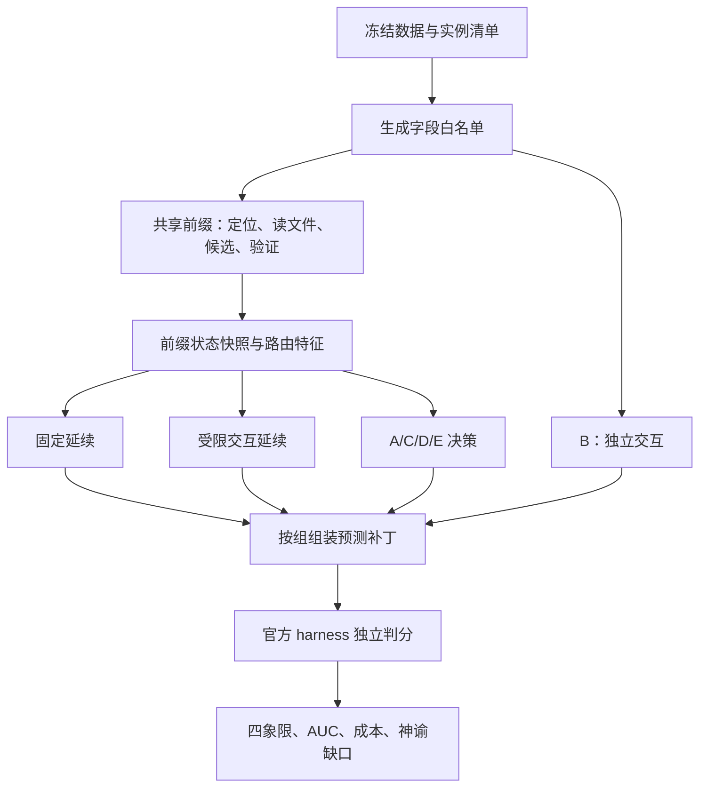

# 项目整体分析（2026-10-29）

分析基准：Git `3759265`。本报告基于本地源码、协议、实验记录、预测与判分 JSON，以及现有 PPT/讲稿正文。没有调用在线模型、启动容器、重新判分或核实外部服务的最新规格与价格。源代码与原始实验文件保持原样。

## 1. 总体判断

这是一个研究“仓库级程序修复中，何时值得从固定流程升级到受限交互”的实验框架。项目已经有数据冻结、模型生成、容器内验证、五组提交、官方 harness 判分和反事实分析的完整开发集样例，工程成熟度超过概念演示。

目前仍处在开发联调与方法验证阶段。核心研究主张尚未得到现有实验支持：最新 7 个开发实例上，自适应组 D 和简单级联组 C 的决策及最终补丁完全相同；配置中的阈值、前缀比例和模型版本仍待冻结。同时发现分支隔离、预算执行和统计口径的实现问题，需要先修正，才能把结果差异归因于路由策略。

项目最有价值的部分是“共享前缀 + 配对分支 + 独立判分”的可审计实验设计。当前最需要补齐的是主驱动对这些约束的实际执行。

## 2. 研究问题与五组设计

每个实例先接收 bug 描述与仓库快照。A/C/D/E 共用前缀，前缀提取定位分歧、补丁重复率、候选可应用性和公开验证信号；然后在一个固定决策点决定继续固定生成、进入交互，或冻结已有候选。

| 组 | 方法 | 实际比较的问题 |
| --- | --- | --- |
| A | 共享前缀后固定延续 | 不使用交互能做到什么 |
| B | 从零开始受限交互 | 前缀本身是否值得保留 |
| C | 共享停止规则后，所有可继续实例都升级 | 简单级联能做到什么 |
| D | 共享停止规则后，用失败证据决定走向 | 证据能否减少无效升级 |
| E | 共享停止规则后，以固定概率升级 | 证据是否优于随机选择 |
| ESC | 单独提交原始交互分支结果 | 填满反事实矩阵；不是第六个对照组 |

应区分“补丁能应用”和“公开测试通过”：现有 C 的停止条件是公开测试通过等共享停止规则，并非只要存在可应用补丁就停止。协议 §3 对 C 的简写容易产生歧义，应统一为代码中的精确定义。

研究标签是“固定分支失败、交互分支成功”。四象限分别表示双成功、仅固定成功、仅交互成功、双失败。AUC 衡量前缀特征能否识别第三类，神谕缺口闭合率衡量路由捕获了多少可达增益。指标可以为负，分母没有增益空间时应为未定义；不宜机械要求始终位于 [0,1]。

## 3. 架构与运行链路

上图表示设计目标；实际实现的分支串扰见第 6 节。

| 层次 | 文件 | 职责与评价 |
| --- | --- | --- |
| 实验编排 | `scripts/run_cf.py` | 跑前缀、固定、升级和 B 会话，再组装五组预测；目前是 dev 联调入口 |
| 共享前缀 | `src/swe_repair/prefix.py` | Docker 容器、词法与模型定位、上下文读取、候选生成、应用/编译/公开测试 |
| 交互执行 | `src/swe_repair/interact.py` | 六种工具、四类状态标签、停滞检测、调用限额、强制收尾 |
| 状态 | `src/swe_repair/state.py` | 任务、定位、候选、失败、预算、决策轨迹；支持 JSON 回放 |
| 路由 | `src/swe_repair/router.py` | 按配置顺序短路执行八条规则，共享停止规则与分组策略 |
| 资源预算 | `src/swe_repair/budget.py` | token、模型调用、工具调用、时间的四元资源核算 |
| 金额预算 | `src/swe_repair/spend.py` | 请求前估算与请求后记账，限制模型费用 |
| 模型接入 | `src/swe_repair/llm.py` | DeepSeek 兼容接口、重试、工具消息与 token/费用记录 |
| 价格计算 | `src/swe_repair/pricing.py` | 项目内日期化价格表、缓存命中和北京时间费率估算 |
| 错误信号 | `src/swe_repair/fingerprint.py` | 输出分类、栈帧提取、错误归一化和指纹 |
| 补丁处理 | `src/swe_repair/patchutil.py` | 文件/行数统计和 hunk 行数修复 |
| 校准 | `src/swe_repair/calibration.py` | 两个数值阈值的网格比较、敏感性与 E 组概率估计 |
| 运行日志 | `src/swe_repair/runlog.py` | 19 个必填字段、schema、校验器、JSONL 与指纹 |
| 反事实分析 | `src/swe_repair/cf.py`、`scripts/analyse_cf.py` | 分支结果拼接、四象限、特征 AUC、策略成本、组间等价检查 |
| 基线 | `scripts/run_baseline.py` | 早期单轮固定流程；信息边界不同，不等同于 v2 的 A 组 |

其余脚本主要分为数据冻结与金标准覆盖统计、镜像预拉与网络诊断、WSL/Docker 安装、基线汇总，以及周报图/PPT/讲稿生成。Windows PowerShell 负责宿主配置，正式容器流程面向 WSL/Linux，常用环境路径为 `/opt/swe-env`。

包的主体共 14 个 Python 文件、5021 行；脚本中有 21 个 Python、32 个 Shell、4 个 PowerShell 文件；测试是 9 个 Python 文件、170 个测试函数。没有 `pyproject.toml` 或统一安装入口，脚本通过修改 `sys.path` 导入 `src`。

## 4. 数据与已有结果

### 数据范围

- 原始 SWE-bench Lite 清单为 dev 23、test 300；`data/raw` 留存原始 schema，`data/harness` 提供评测所需的扩展 schema。
- 本次核对四份 parquet 的 SHA-256，均与对应 manifest 相符；两份冻结实例清单的数量、唯一性与清单哈希也相符。当前 Python 缺少 pyarrow，因此没有重新解析 parquet 逐列比较两个命名空间的数据内容。
- dev 金标准扫描为 15/23，通过失败重跑的 8 个实例仍未解决。这证明当前环境与该参考补丁组合有稳定失败，不能从逻辑上推导“任何可能的补丁都无法通过”。原文部分“绝对不可解”的措辞应收窄。
- test 的本地判分证据覆盖 98/300，98 个均通过金标准；构成为 django 92、astropy 6。另外 202 个是尚未覆盖，不能当作失败或已验证。
- 协议把这 98 个定义为便利子集，不能支持完整 300 个实例或全部 12 个仓库的泛化结论。仓库内尚没有对应的五组主实验结果。

### 反事实联调结果

下表直接取各组官方判分 JSON 的 `resolved_instances`。各批协议与执行器版本不同，仅记录各批状态，不作跨版本方法效果比较。

| 批次 | 实例数 | A | B | C | D | E | ESC | 整批生成估算费用 |
| --- | ---: | ---: | ---: | ---: | ---: | ---: | ---: | ---: |
| `cf_dev4` | 4 | 1 | 0 | 2 | 2 | 1 | 1 | 1.209561 CNY |
| `cf_dev7_v22` | 7 | 3 | 1 | 3 | 3 | 3 | 1 | 1.344464 CNY |
| `cf_dev7_v23` | 7 | 3 | 4 | 4 | 4 | 3 | 4 | 0.865986 CNY |

最新 v2.3 的四象限为 2/1/2/2，神谕为 5/7，记录中的缺口闭合率为 `(4-3)/(5-3)=0.5`。`u_loc` AUC 为 0.4，`u_dup` 为 0.5，缺少行为信号为 0.55，`n_applicable` 为 1.0；样本只有 7 个、正例只有 2 个，只能用于诊断和提出假设。

三批 C、D 的逐实例决策一致，预测文件中的 C、D 补丁映射也完全一致。v2.3 中两者都是 3 次停止、4 次升级；D 没有选择过固定延续。因此“这轮自适应策略优于简单级联”尚无证据。

早期单轮基线合并摘要记录 6/15，且有 2 个 `not_scored`。它包含不同参数的补跑，并使用了 v2 禁止的额外信息，不能拿来直接与上述 A 组作严格对照。

## 5. 已具备的工程优点

1. 生成和评测做了显式分离。新反事实入口使用 `generation_view()` 白名单，状态层递归拒绝隐藏评测字段；前缀从 checkout 发现公开测试。
2. 配对反事实设计减少重复生成成本，使后续策略可以在同一分支结果表上比较。路由决策取冻结边界的状态，而不是根据事后结果反推。
3. 失败现场与版本修正留档较完整：预算档不足、缺失失败记录、空补丁、测试发现不足都有原始矩阵或实验记录。
4. 基础逻辑有较多离线测试，尤其覆盖路由顺序、缺失定位、错误分类、成本核算与神谕边界。
5. 数据文件和清单具有可核验的哈希，报告保留各组预测与判分文件，便于重新核对数字。

这些优点是后续修正的基础；不能代替主流程的集成验证。

## 6. 优先处理的问题

### P1：固定分支结果串入交互分支，破坏共同起点

位置：`scripts/run_cf.py:184`、`:221`、`:241`。

`prefix_state = _attach_budget(prefix.state, ...)` 没有复制状态。固定延续随后调用 `prefix.state.patches.add(validated.candidate)`；交互分支的 `escalation_seed(problem, prefix)` 又读取这个已被修改的候选历史。只要固定延续产生非空候选，升级分支就可能额外看到它和验证状态。

本次使用假容器与假模型执行 `run_one()`：冻结快照中不含固定分支标记，而升级提示中含该标记，已复现。这会让实际交互分支比设计中的“仅继承前缀”多获得一轮固定生成及验证信息，策略成本却只计算前缀与交互，信息与成本都可能不匹配。

建议：在边界创建独立的序列化快照；固定分支、升级分支分别恢复。升级提示必须从冻结快照及冻结上下文构造，避免读取固定分支写回的对象。

### P1：真实 C 组和“无条件跑 ESC”的假想策略混用

位置：`scripts/analyse_cf.py:188`、`src/swe_repair/cf.py:337`，周报 PPT 第 5 页与讲稿相关段落。

正式 C 组遵守共享停止规则；分析中的 `C_escalate_all` 使用 `lambda o: True`，在所有实例上采用 ESC，即使前缀公开测试已经通过。两者是不同策略。

v2.3 的真实 C、D 均升级 4 次。按矩阵中真实 C 的决策重算费用，C 为 **0.574337 CNY**，与 D 相同；分析中的无条件 ESC 为 **0.688450 CNY**。因此 PPT 第 5 页“D 升级 4 次、C 升级 7 次”和“D 比 C 便宜”比较的是不同定义；第 6/9 页又使用真实 C 的 4 次升级，前后口径冲突。

这一混用在 v2.2 更明显：真实 C 解决 3 个，无条件 ESC 只解决 1 个。不能把两者共用一个 C 名称。

建议：增加按 `decisions['C']` 评分的 `C_actual`；将原有策略明确命名为“不遵守共享早停的强制交互策略”，单独作为诊断。同步修正文稿与汇报口径。现有原始判分文件无需改写。

### P1：四元预算没有贯穿实际执行

位置：`scripts/run_cf.py:272`、`:323`、`:506`；`src/swe_repair/interact.py:360`、`:406`、`:454`。

- 主驱动在前缀结束后才附加预算，只填前缀 token/模型调用，工具和时间均记为 0；分支未共享并持续扣减该预算。`prefix_fraction=0.30` 没有控制前缀实际开销。
- `--per-instance-cny` 在反事实入口中只被显示和记录，没有成为逐实例守卫。批次总金额守卫存在，但不能代替每个策略的资源预算。
- 工具预算只在模型回合开始前检查。一个回复带多个 tool call 时，内部循环可越过工具上限。
- 强制收尾在达到调用上限后额外调用一次模型，当前实现是“上限外增加”，并非“上限内预留”。v2.3 多个会话声明 6 次、实际记录 7 次。
- 时间上限只在回合边界检查，单次请求与重试可能跨过截止时间。

无网络模拟中，将会话限为 1 次模型调用、1 次工具调用，一个包含 3 个工具请求的回复最终产生 **2 次模型调用、3 次工具调用**，已复现。协议对联调额外收尾有留痕，但正式等预算比较仍需明确这一次算在何处。

建议：每个候选策略从同一份已消费前缀预算复制剩余额度；每次模型/工具调用前预检并实时扣账；收尾占用预留额度；时间使用统一截止时间。反事实采集的总费用与策略模拟费用分别报告。

另：早期 `run_baseline.py:368` 用批次累计 `guard.spent_cny + worst` 对比单实例限额，可能把单实例上限错误地施加到整批累计费用。

### P1：失败、未评测和真正未解决没有完整分开

位置：`scripts/run_cf.py:413`、`:424`、`:448`；`scripts/analyse_cf.py:62`、`:169`。

`run_one()` 完整返回后才把实例加入 outcomes。若固定分支调用或校验中途抛异常，已完成前缀等部分成果只剩一条批次错误信息，不进入正式预测分母。分析脚本又仅保留 `resolved_ids`：只要 A/ESC 报告存在，“不在 resolved 集合”就被设为 False，无法区分未提交、未评测、环境错误和真正未解决。

当前三批提交数量与实例数量完整，尚未从这些文件发现该问题造成的现有漏项；这是异常路径与后续大规模运行的风险。

建议：以预先指定的实例清单为总表，逐阶段持久化，保留 `not_submitted/not_scored/infra_error/unresolved/resolved` 等明确状态；方法解决率固定分母，四象限分析另报配对完整样本数。批次失败不能静默退出实验总体。

### P2：冻结配置哈希没有覆盖实际配置

位置：`src/swe_repair/router.py:108`、`:133`；`scripts/run_cf.py:338`、`:509`。

`digest` 对 `raw` 计算哈希，`with_thresholds()` 只修改实例属性，仍保留原 `raw`。因此从 null 改为 0.5 后，哈希不变。本次已用离线模拟确认。demo 预算、CLI 调用限额、模型输出限额等也不全在这个哈希内。

另外，`llm.py` 能创建逐调用记录，但反事实入口没有持久化完整 CallRecord、served_model、交互 transcript/trace 或完整边界快照；`RunLogger` 和状态决策轨迹没有真正接入该主循环。矩阵有调用摘要和规则表，审计精度仍低于模块接口所承诺的程度。

建议：构造包含全部生效值的 effective config，再计算实验哈希；额外记录代码提交、数据清单哈希、镜像 digest、服务端模型标识和逐阶段日志。同一 tag 重跑应防覆盖，支持从持久化检查点继续。

## 7. 路由特征与执行器的其他限制

1. **定位分歧包含路径表示差异。** 前缀在路径解析前用词法尾路径与模型仓库路径计算 Jaccard。例如 `marshmallow/schema.py` 和 `src/marshmallow/schema.py` 即使指向同一文件，也产生 `u_loc=1.0`。这是已复现的特征构造问题；应先统一到实际仓库路径，再评估“分歧高就升级”是否成立。把词法和模型定位称为统计独立也缺少保证，它们读取同一 bug 描述。
2. **上下文顺序不够可复现。** 模型文件被转为 frozenset，后续 `list(model_files)` 不保持模型排序或稳定排序；在 4 文件、60000 字符上限下，顺序可能改变可见上下文。
3. **交互 run_test 的源文件入口错误。** `interact.py:256` 对任何 `.py` 都直接交给 pytest，因此传 `package/module.py` 会直接跑源文件，而不进入“发现相邻测试”的路径。使用假测试执行函数已确认目标选择如此。
4. **测试反馈过于压缩。** `run_test` 仅返回状态与摘要，忽略原始 traceback；模型很难据此作下一轮有针对性的修复。前缀也只把候选状态摘要交给升级提示。
5. **四状态目前主要是标签。** `final_state` 按工具赋值，没有显式合法状态转移约束；“每轮一个工具”也主要依赖提示词。
6. **补丁编辑默认整体替换。** 每次 `apply_patch` 都先回滚 checkout，只保留最近一次成功 diff；模型若按常见交互编辑方式提交增量补丁，前一次修改会被移除。应明确工具契约，或改为累积编辑后从 git 导出最终 diff。
7. **环境失败信号未完整连接。** 前缀仅对 status=fail 的公开测试写失败记录；pytest 缺失、收集失败或超时返回 not_run，且实际驱动没有执行“一次确定性环境恢复”的完整流程。
8. **校准与最终路由不完全一致。** `calibration.decide()` 只比较 u_loc/u_dup，不回放共享停止、范围外栈帧和无行为信号规则。局部最优阈值未必改善最终八规则策略；正式校准应针对完整策略验证。
9. **旧基线存在信息越界。** `run_baseline.py:101` 用 FAIL_TO_PASS 提供测试路径，`:184` 使用 hints_text；v2 协议已明确禁止。旧结果可作历史链路证据，不能当作相同信息预算下的公平基线。
10. **环境与文档仍有漂移。** requirements 使用下限约束而非锁定依赖，镜像使用 latest；README 还保留 142 与 170 两种测试计数，协议末尾 max_tokens=8192 与实际运行 16384 不一致；交付说明称 12 页，现有 PPT 实际 11 页。实验记录已写 v2.1/v2.2，尚未追加对应 v2.3 的完整记录。

这些问题中，路径规范化、分支隔离、工具限额和统计定义都可以先通过离线验证处理。规则 4/7 如何重设属于方法设计，宜在执行器和证据定义稳定后形成新协议，再在 dev 上校准。

## 8. 本次实际验证

| 检查 | 结果 | 解释 |
| --- | --- | --- |
| 44 个 Python 文件的 AST 语法解析 | 全部通过 | 覆盖 src、Python scripts、tests；不等同于集成运行 |
| 四份 parquet SHA-256 | 4/4 一致 | 与冻结 manifest 对照 |
| dev/test 实例清单 | 23/300，唯一且哈希一致 | 没有改写数据 |
| 三批反事实预测 | 24/42/42 行，无重复实例-组键 | C、D 的补丁逐项一致 |
| 费用摘要复核 | 分阶段之和与总守卫差约 0.000001–0.000006 CNY | 来自逐段舍入，未发现有意义的总额差异 |
| 标准离线测试 | 155/170 通过 | 15 个客户端测试均因当前 Python 缺 requests 失败；不能宣称本机 170/170 |
| 临时目录问题 | 已绕开 | 初次使用默认沙箱临时目录另有权限错误；将 tempfile 定位到 workspace/work 后消失 |
| 无网络模拟 | 复现分支串扰、配置哈希不变、调用/工具越限、源文件测试路径问题 | 使用假客户端与假容器，不测真实服务和 Docker |

测试输出留在忽略目录 `work/analysis_offline_tests.txt`。当前默认 Python 为 3.14.2，缺少 requests；本次没有安装依赖。没有运行新的模型付费实验，也没有重跑现有官方判分。PPT/讲稿仅抽取正文用于核对论述，没有进行版式验收。

现有测试主要覆盖纯逻辑。`test_interact.py` 明确未覆盖会话主循环，仓库没有专门的 prefix 测试和 run_cf 编排集成测试，因而 170 项这个数量不能保证实验约束已经落实。

## 9. 建议的推进顺序与验收条件

1. **先修实验有效性。** 隔离两分支状态；区分 C_actual 和强制 ESC；落实逐策略预算、调用限额与阶段持久化。验收应包含交换分支执行顺序不改变输入、批量工具不越限、异常实例仍在总体中、真实 C/D 同决策时费用相同。
2. **再修证据质量。** 统一定位路径，稳定上下文顺序，修 run_test 源路径发现与错误反馈。验证特征测量的是仓库差异，而非字符串表示或执行器遗漏。
3. **形成新的完整冻结配置。** 固定预算、收尾调用语义、完整规则和评估池；在 dev 校准并回放完整策略，冻结 effective config 哈希。增加明确的正式运行模式，拒绝占位阈值。
4. **补齐主实验入口。** 当前 run_cf 固定读取 dev.parquet，score_all_arms.sh 也固定 --split dev。需要支持 test 的冻结实例清单、重复编号、检查点恢复、严格覆盖统计和独立输出目录。
5. **最后扩大实验。** 先做少量冻结实例的集成验证，再按协议运行 98 个便利子集与 repeats=3。报告逐仓库结果、方差或配对不确定性，单列未评测与环境错误；原始失败与旧协议结果保留。

最关键的验收不是“D 的解决数更高”，而是能证明：两条分支从相同状态和信息边界开始、各组预算遵守同一定义、失败样本没有改变分母、C 与 D 的差异确实来自路由证据。在这些条件成立之前，现有数字适合作为工程联调证据。
