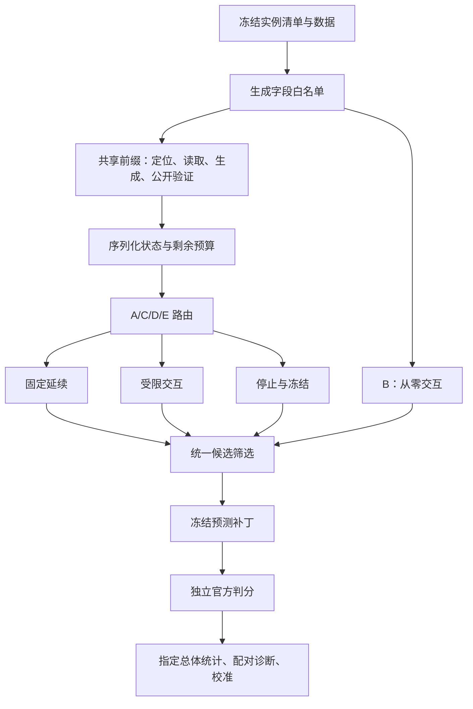

# 项目现状与源码复核

复核日期：2026-10-29。代码基准：`a5b365bd33f068315db0558b0ddd12cfc1e8bbba`。工作开始时 Git 工作区干净。本文是对当前活动实现的复核，不替换针对旧提交 `3759265` 的《项目分析_20261029.md》，也不改写历史实验记录。

本轮阅读开题摘录、当前协议、离线验证说明、配置、README、历史证据说明，以及活动 Python 模块、主入口和相关测试；对安装、代理、镜像和网络脚本做职责与副作用梳理，没有执行。未读取 `.env`，未联系外部服务，未运行 Docker、官方 harness 或模型 API。没有核实供应商当前接口与价格；费用数字只解释项目内记录和估算口径。本机无 pyarrow，本轮没有逐行重新解析 parquet，数据完整性通过保护清单核验。

## 1. 总体判断

项目是一个研究“仓库级程序修复中，失败证据能否帮助选择固定延续或受限交互”的实验框架。它不训练基础模型，也不是通用编码助手；核心贡献候选是**同一模型、同一信息、同一资源上限下的模式选择机制，以及可追溯的配对验证设计**。

当前已有完整的执行与分析骨架，且上一轮修复已落入活动代码：生成字段白名单、序列化前缀克隆、正式/诊断模式分离、实际前缀缓存、逐次预算扣账、统一候选筛选和保留缺失判分的统计逻辑。本轮离线套件与资产校验全部通过。

成熟度仍属于“离线验证后的研究原型”。不能将旧联调的容器成绩、当前 fake 测试和待校准配置拼成新协议的实测证据。本轮也发现几处测试未覆盖的路由、结果关联和校准问题，正式实验前应先处理。

## 2. 研究问题、五组和运行模式

| 研究问题 | 实际要回答什么 | 所需证据 |
| --- | --- | --- |
| RQ1 | 同资源上限下 D 是否改善解决率 | A/B/C/D/E 的完整指定总体与至少三次重复 |
| RQ2 | 前缀证据能否预测交互的增量价值 | 同快照、同剩余预算的固定/交互配对结果 |
| RQ3 | 质量接近时能否减少消耗 | 实际 token、请求、工具、时间和金额的质量成本关系 |
| RQ4 | 哪些失败可恢复，路由如何误判 | 失败类型、误判案例、消融、敏感性与人工语义审查 |

| 组别 | 定义 | 核心作用 |
| --- | --- | --- |
| A | 共享前缀后固定延续 | 固定流程基线 |
| B | 相同初始问题与干净仓库，从零交互 | 比较是否需要固定前缀 |
| C | 共享停止条件之后，所有 eligible 失败均升级 | 简单级联基线 |
| D | 共享停止条件之后，按失败证据选择分支 | 研究方法 |
| E | 按 dev 上 D 的 eligible 触发率随机选择 | 检验证据是否比随机选择更有价值 |

“eligible”指前缀未得到共享停止决定、仍有条件继续的失败。正式模式只运行所选分支；诊断模式采集固定/交互两个分支，还运行独立 B。诊断的双分支费用是研究成本，不能充当 D 的部署成本。ESC 只是交互延续的诊断出口，不是第六个主组，也不等于遵守早停的 C。

D 的规则顺序已经恢复为：环境恢复后仍失败则停止 → 预算不足停止 → 已有公开通过候选则冻结 → 局部应用/语法问题固定修正 → 定位分歧/重复补丁/未检查源码栈证据触发交互 → 证据不足及其他情况固定延续。允许 D 与 C 相同，也允许负收益。

当前配置整体是 `draft-pending-calibration`，`execution.live_authorized=false`。请求模型别名为 `deepseek-flash`，实际服务版本仍为 null；两个阈值和 E 概率也为 null。development 档上限为累计 512000 token、12 次实际模型请求、80 次 container exec、1200 秒；前缀 token 比例 0.30。交互会话另限 6 次模型调用、10 次具名工具、420 秒，单实例/批次金额守卫为 2/6 CNY。这些都是开发安全限额，不能视为已校准预算，更不能据此推定获准运行。

## 3. 架构与数据流



图中固定与交互是可选路线，正式模式每组只执行所选路线；配对诊断才执行两个备选分支。独立评测结果不回流到同次生成。

活动包为 17 个 Python 文件、5837 行；Python 入口 11 个、955 行；测试 14 个文件、3152 行。另有 17 个 Shell 和 4 个 PowerShell 脚本。行数含注释与空行，仅用于说明规模。

| 层次 | 主要文件 | 当前实际行为 |
| --- | --- | --- |
| 计划与执行 | `scripts/run_cf.py` | 默认只打印计划；live 执行需显式开关、配置授权及相应预检；独立 tag 保存矩阵、事件和预测 |
| 实例编排 | `experiment.py` | 检查镜像身份和 base commit；前缀缓存与克隆；只执行正式所选分支或采集诊断分支 |
| 固定前缀 | `prefix.py` | 词法定位与一次模型定位；最多读取 4 个文件、约 60000 字符；默认生成 2 个候选并验证 |
| 状态与信号 | `state.py`、`fingerprint.py` | 任务、定位集合、候选、失败、上下文、预算与轨迹；计算 Jaccard 分歧和重复率 |
| 路由 | `router.py` | 九条有序规则；A/C/E 共用停止条件，D 完整规则回放 |
| 交互 | `interact.py` | 六种工具、每回合最多执行一个工具、会话限额、停滞控制、上限内预留最终生成 |
| 全局资源 | `execution.py`、`budget.py` | 每次请求与 container exec 预检；继承前缀消耗；失败请求保守预留；截止时间限制 |
| 模型与金额 | `llm.py`、`spend.py`、`pricing.py` | 注入假 transport 或显式 live 接入；批次与实例金额守卫；服务模型检查；金额为估算 |
| 补丁 | `patchutil.py`、`state.PatchHistory` | hunk 计数修正、修改范围限制；保留历史有效候选，按公开验证、规模与顺序选择 |
| 判分与分析 | `score_all_arms.sh`、`analyse_cf.py`、`cf.py` | 外部 harness 判分；保留缺失/错误状态；真实组、四象限、AUC 和神谕上界分开 |
| 校准与统计 | `calibration.py`、`statistics.py` 及对应入口 | 完整 D 规则网格回放；E 触发率匹配；分层抽样；实例 cluster bootstrap |
| 日志辅助 | `runlog.py` | schema、验证、JSONL 和哈希工具；主驱动主要写矩阵和 events，尚未全面接入该统一行记录 |
| 保护与环境 | `verify_preservation.py`、`scan_gold.py`、环境脚本 | 资产哈希核对、默认 gold 计划；环境准备脚本含安装/联网/拉镜像副作用，本轮未执行 |

候选必须针对干净基线，不能依赖上次补丁。实际筛选排除无法应用、语法失败、越界和空补丁；公开通过者优先，再比较文件数、修改行数和生成顺序。公开测试主要通过文件名和符号搜索发现，最多选择 3 个文件，统一用 pytest；这是一种需真实集成验收的启发式，不能假定适配全部仓库。

## 4. 数据与历史结果应如何理解

dev 清单为 23 个唯一实例、6 个仓库；test 为 300 个唯一实例、12 个仓库。`data/raw` 保存原始数据，`data/harness` 是用于官方评测扩展 schema 的另一份来源。manifest 记录两者实例 ID 集合一致；仅此不能证明所有正文、提交和评测字段逐值相同，本轮未进行该语义比较。

历史 dev gold 覆盖记录为 15/23；test gold 只覆盖 98/300，剩余 202 个未验证。98 个集中在 django 92、astropy 6，不能自动作为代表 300 个实例的主总体。环境失败应保留，不得据此推断所有补丁都不可解。

直接读取旧判分得到：

| 历史批次 | 提交实例数 | A | B | C | D | E | ESC |
| --- | ---: | ---: | ---: | ---: | ---: | ---: | ---: |
| cf_dev4 | 4 | 1 | 0 | 2 | 2 | 1 | 1 |
| cf_dev7_v22 | 7 | 3 | 1 | 3 | 3 | 3 | 1 |
| cf_dev7_v23 | 7 | 3 | 4 | 4 | 4 | 3 | 4 |

这些是旧实现各批次的解决数，不是新协议主成绩，不能拼接成三个正式重复。最新旧 v2.3 的 C/D 路由与最终补丁映射完全一致；已有更正分析中两者均升级 4 次、估算策略成本均为 0.574337 CNY。因此现有材料不能支持“D 优于真实 C”或“D 比真实 C 省钱”。旧无条件 ESC 的成本不能冒充 C 成本。

## 5. 当前代码中需要处理的问题

以下 P1 指正式研究前应优先处理的有效性问题，P2 指定义、监控和分析完整性问题。离线合成复现位于 `runs/project_review_20261029/`，与真实实验数据分开。

### P1：范围外源码证据缺少可靠的来源判定（已离线复现）

位置：`fingerprint.py:126–167`、`router.py:253–260`。

外部绝对路径无法归入仓库时，被 `normalise_repo_path()` 降为 basename；随后 `repo_frames()` 将任何 `.py` 帧收集为仓库帧。合成的 `/opt/venv/lib/python/site-packages/dependency/helper.py` 因此变成 `helper.py`，单独触发 D 的 `interactive_on_out_of_scope_stack_evidence`。这会把第三方依赖/测试运行器证据误读成“仓库内尚未检查的源码调用关系”。

此外，路由只排除了 `test/`、`tests/` 和 `test_` 前缀，没有排除 `*_test.py`；合成的 `/testbed/pkg/widget_test.py` 同样触发交互。补丁范围检查却已排除 `_test.py`，两处测试识别口径不一致。

建议保留原始路径与明确的归属标记，只让确认属于 checkout 的源码进入该触发器；统一测试路径分类。外部帧仍可保留在日志中，但不构成升级证据。

### P1：判分报告与本次预测缺少强关联（已离线复现）

位置：`scripts/analyse_cf.py:73–81`、`:155–170`；`scripts/score_all_arms.sh:25–28`。

分析器主要按实例 ID 查找标签。它记录输入报告文件自身的 SHA-256，但没有核对报告对应的预测文件哈希、模型/arm 标签、run id、split 与配置身份。合成报告携带 `UNRELATED_OLD_RUN`、不同 config hash 和不同预测哈希，仍被接受为当前实例的 resolved，产生 100% 解决率。

这是误关联风险的复现，不代表现有历史判分已经被串用。建议判分时保存 matrix、预测文件及每个实例补丁哈希、run id、arm、split 和配置身份的 sidecar；分析器默认拒绝不匹配或缺少必要关联的正式输入。报告哈希只能证明“读了这个文件”，不能证明“这个文件判的是这次补丁”。

### P1：E 概率估计的分母依赖判分完整性（已离线复现）

位置：`scripts/analyse_cf.py:83–88`、`scripts/calibrate_router.py:28–37`。

分析器只将双分支标签完整的 eligible dev 实例放入 `observations`，校准入口又仅从这些 observations 计算 D 触发率。阈值选择需要已知配对标签，但 E 的匹配概率应来自**所有 eligible dev 前缀的 D 决策**，无需等待该实例的两个最终标签。

合成例中两个 eligible 前缀的 D 路由为“交互、固定”；第二个缺少判分后，所有 eligible 的触发率是 0.5，当前 observations 路径得到 1.0。若缺失判分与环境或策略有关，E 基线会随之偏移。

建议分别保存全部 eligible 前缀与已判分配对观察；在后者选阈值，再对前者回放完整 D 规则以估计 E 概率，并报告两种分母和缺失原因。

### P1：容器层面尚不能保证分支从完整干净环境开始（静态确认，真实影响未验证）

位置：`experiment.py:145–147`、`prefix.py:135–139`。

Python 状态已经独立克隆，但诊断分支使用同一个存活容器，清理仅为 `git checkout -- .` 和 `git clean -fdq`。该方式不清理忽略文件、仓库外文件和持续运行的进程，也不检查清理是否成功；例如固定分支测试生成的忽略文件可能影响随后交互分支。`/tmp/candidate.diff` 也属于容器共享状态。

这不是旧的候选对象串扰再次出现，而是另一层隔离缺口。建议以同一镜像和 base commit 建立独立分支容器，或提供经过验证的完整环境重置与失败即终止机制。当前 fake Box 的 revert 基本为空操作，不能证明该性质。没有运行真实 Docker，所以本轮不声称已经观察到实际容器污染。

### P2：固定延续只追加一次生成，基线能力边界需要明确（已离线复现）

位置：`experiment.py:159–171`。

固定分支没有延续循环，一次请求后即结束，即便模型没有给出补丁、没有公开通过、仍有大量预算。合成例在还剩 11 次全局模型请求额度时以 completed 结束。交互分支则有多轮循环和最终生成。

相同硬上限不要求所有策略强行耗尽预算，因此这不是费用越限；但若论文将 A 描述为持续固定流程、用剩余预算反复修正，则与实现不符，也可能把固定执行器较弱与路由价值混在一起。应预先决定固定延续的轮数、反馈使用和早停规则，并通过配置冻结，而不是观察成绩后再选择较有利的定义。

### P2：阶段预算终止被实例总状态覆盖（已离线复现）

位置：`experiment.py:183–200`。

阶段可记录 `budget_exhausted`，但实例总状态只检查是否存在 `generation_error`，否则一律 completed。合成例得到 `stages.fixed.status=budget_exhausted`、`case.status=completed`。细节仍留在阶段记录中，但只看顶层状态的监控或失败分类会漏报。

建议将“流程已结束”与终止原因分开；顶层保留预算耗尽、环境失败、模型错误等原因，并由分析器显式读取。不能将 completed 当作修复成功；现有分析器已没有这样做。

### P2：审计和统计链条还有未闭合处（静态审查）

- `interact.py:399` 的四状态目前主要是工具到状态的标签映射，没有显式的合法状态转换校验；模块说明中“状态机约束”强于实际实现。
- `validate_candidate()` 构造测试失败记录时统一写退出码 1（`prefix.py:523`）；真实 pytest 退出码及 timeout 等类别没有完整保留在结构化失败字段。原输出还在事件/trace 中，可审计，但分类型统计需要补齐。
- `analyse_cf.py:99–107` 的评测行缺少生成 seed、run id 和预测哈希；汇总虽然校验配置哈希和重复网格，仍不能充分核对跨 arm 的同 seed 配对身份。
- `statistics.py` 已有指定总体、逐仓库、宏平均和实例 cluster bootstrap，但当前汇总入口没有产出协议要求的“各组均可运行共同子集”分析，也没有完整的多资源质量成本曲线。
- 默认前缀只有两个候选，按当前重复率定义最大值为 0.5；路由使用严格大于阈值，网格中的 0.5 和 0.75 都不会触发重复规则。这是参数可辨识性限制，应在 dev 校准报告中显式说明。
- 正式入口预检主要核对模型版本非空、两个阈值、E 概率和 test 的总体状态，尚未将模型/前缀校准标记、候选选择冻结、evaluation 冻结等组成完整的一致性验收；不能仅改状态字符串宣布冻结。
- requirements 是下限版本，主驱动保存源码内容哈希但没有直接保存 Git 提交与完整运行环境锁定；正式复现还需记录这些身份。辅助环境脚本还残留指向已退役 `freeze_dataset.py` 的提示，应清理，不能据此恢复旧入口。

## 6. 本轮验证证据与边界

| 项目 | 本轮结果 | 解释 |
| --- | --- | --- |
| 活动源码修改 | 无 | 仅新增本报告、合成复现脚本及其结果 |
| 活动离线套件 | Python 3.14.2，222/222 通过 | runner 禁止网络，假模型/假容器和纯逻辑测试 |
| 原始资产 | 93/93 SHA-256 一致 | 缺失 0、改写 0、无效路径 0 |
| 归档原件 | 131/131 一致 | 缺失 0、改写 0、无效路径 0 |
| 新边界复现 | 6 项观察已记录 | 全为合成输入，不能用于计算方法效果 |
| 当前真实容器验证 | 未进行 | 没有启动容器、拉镜像或测试真实公开命令 |
| 当前付费生成 | 未进行 | 授权仍关闭，没有读取密钥 |
| 当前独立判分 | 未进行 | 只读取历史报告，没有重跑 harness |
| dev 校准/主实验统计 | 未完成 | 当前版本没有新的真实配对、冻结阈值或三次正式重复 |
| 消融/敏感性/人工审查 | 未完成 | 不能认为 RQ4 已得到回答 |

复现命令（均不调模型、不运行容器）：

```powershell
python scripts/run_offline_tests.py
python scripts/verify_preservation.py --archive
python runs/project_review_20261029/offline_probes.py
```

合成结果保存在 `runs/project_review_20261029/offline_probe_results.json`，其 `kind` 为 `synthetic_source_review_only`。这些复现是对现存行为的观察，不应计入活动套件的“通过测试数”，也不能混入 evaluated_records。

## 7. 后续工作的顺序

1. 先完成源码边界修正：源码帧归属与测试识别、判分关联、E 分母、完整分支隔离、顶层终止状态；同时冻结固定延续的实际定义。
2. 增加对应的离线回归，重跑全部活动测试和原始资产保护检查。补齐评测行的运行身份、失败分类及共同可运行子集等分析出口。
3. 当前授权范围内可继续准备 dev 集成验收清单、完整校准和消融预注册，但不执行真实环境或付费生成。
4. 将来获得明确授权后，先在少量 dev 验收真实模型、工具、补丁应用和公开测试；分别记录环境不可运行、接口/能力失败与资源不足，保留全部 23 个 dev 的总体记录。
5. 用 dev 校准完整 D 策略、前缀占比、固定/交互步数和预算，按全部 eligible 前缀匹配 E；审阅并冻结模型版本、参数、提示、代码、环境与完整配置。
6. 在观察正式成绩前确定 test 300 或预注册分层子集；完成至少三次重复、独立判分、实例 cluster 区间、逐仓库与宏平均，再完成信号/反馈/停滞消融、敏感性和人工语义抽查。

研究价值最终取决于是否在可比执行器和信息边界下，识别出固定与交互的互补条件。现有工程为此提供了基础；当前材料还不能证明混合策略带来质量收益或成本节省。

即使工程边界修正完毕，研究解释仍需控制三个限制：dev 只有 23 个实例、6 个仓库，对 12 个 test 仓库的阈值泛化不确定；当前定位分歧来自词法与一次模型定位的差异，其预测价值需要实测，不能直接解释成模型置信度；公开测试通过不足以保证语义正确，必须依赖冻结后的独立判分和分层人工复核。
